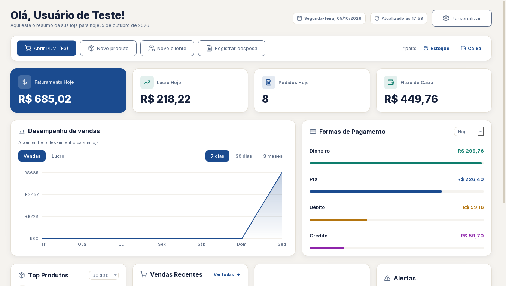
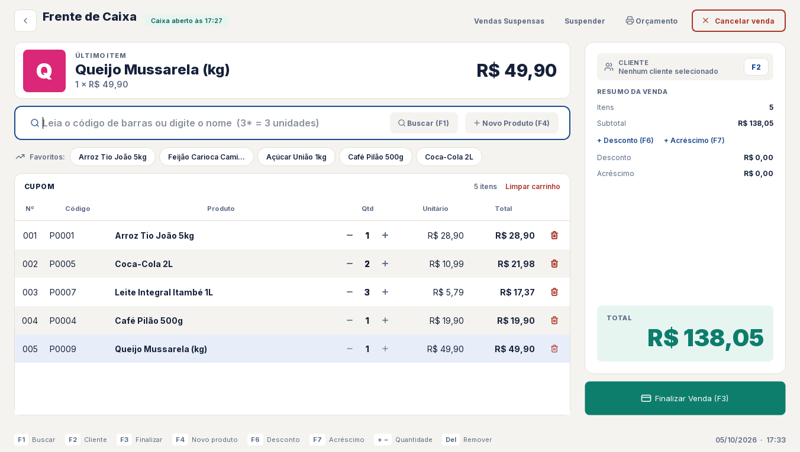
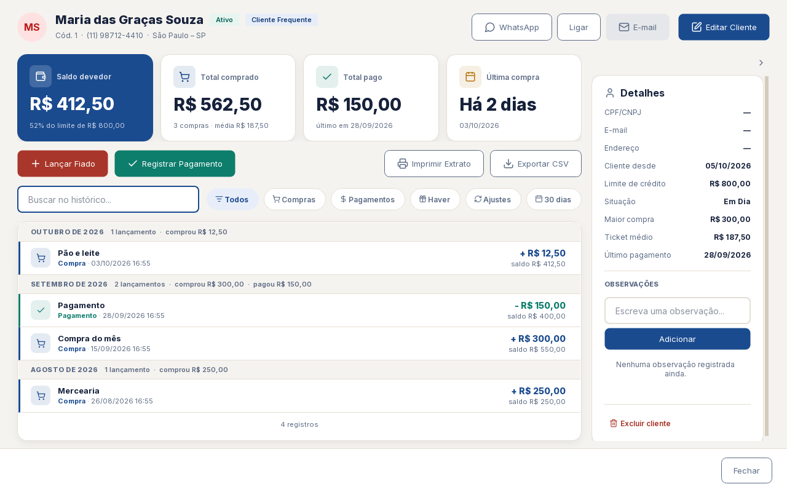
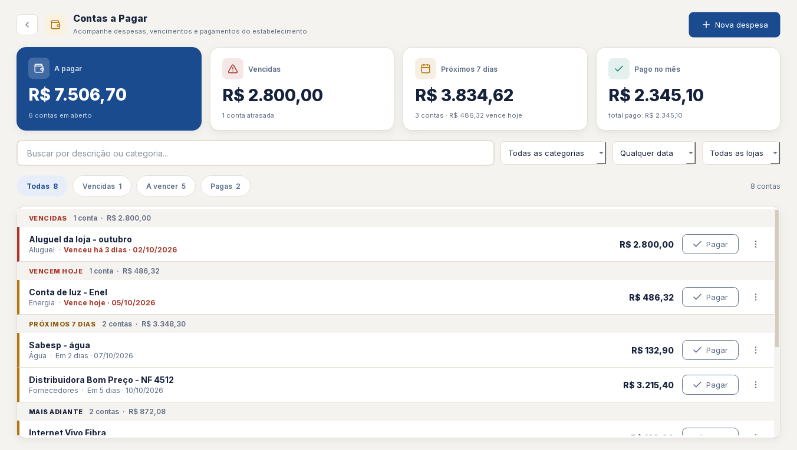
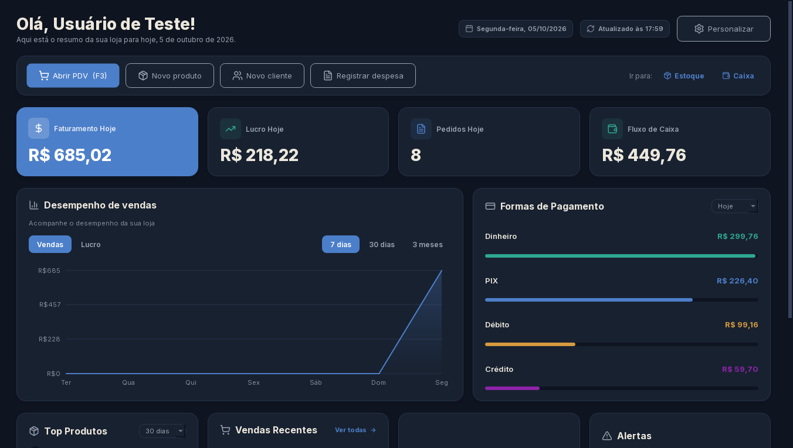
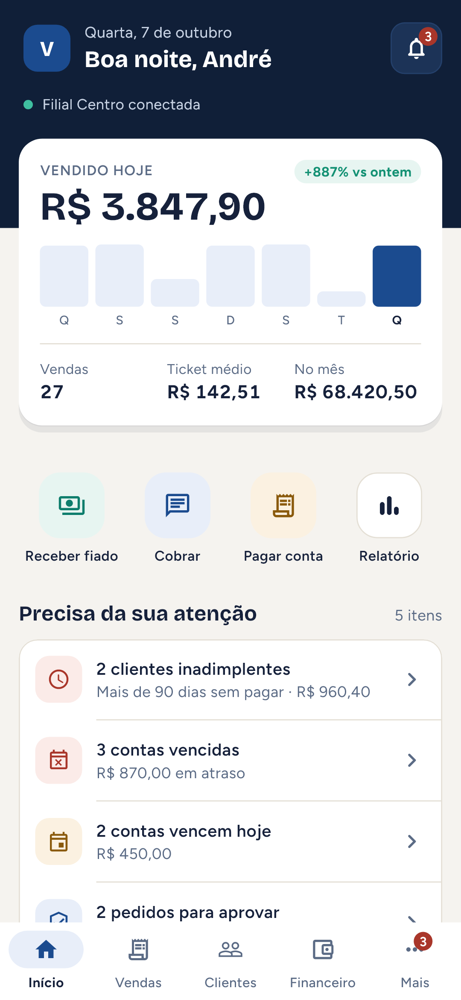
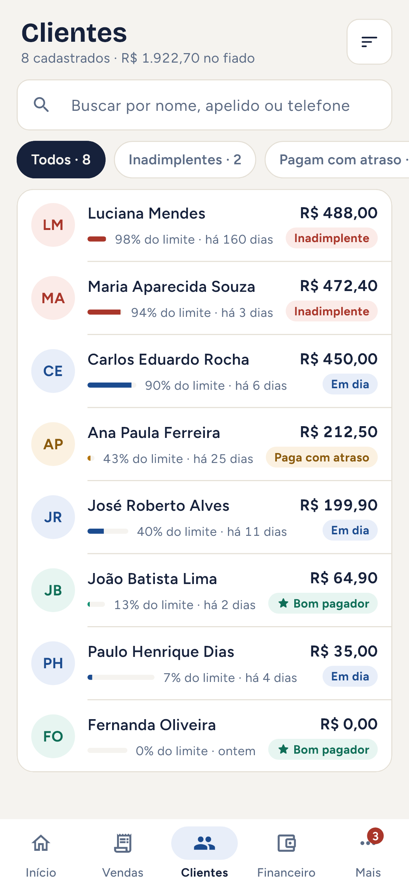
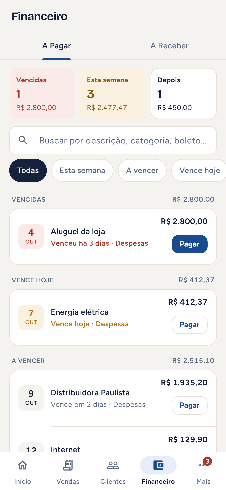

# Vertex ERP

**Sistema de gestão completo para o varejo brasileiro — em produção numa loja real, com matriz e filial.**

PDV, estoque multi-loja, fiado, caixa, contas a pagar e a receber, conciliação bancária e relatórios, num app desktop para o balcão e num app Android para acompanhar a loja de qualquer lugar.


-41CD52?logo=qt&logoColor=white)




## Em uso de verdade

O Vertex ERP roda todos os dias numa loja de varejo: o computador do balcão é o servidor, a filial se conecta a ele pela rede e o dono acompanha vendas, caixas e contas pelo celular. As funcionalidades nasceram de necessidades do dia a dia da loja, e as correções, de problemas que apareceram em uso.

## Funcionalidades

**Vendas e caixa**
- Frente de caixa (PDV) com leitor de código de barras, atalhos de teclado, favoritos, venda suspensa e orçamento
- Abertura e fechamento de caixa com conferência, sangria e suprimento
- Devoluções, cancelamentos e cupom na impressora térmica (ESC/POS)
- Comprovante pelo WhatsApp

**Clientes e fiado**
- Ficha do cliente com extrato, limite de crédito e saldo devedor
- Classificação automática (bom pagador, paga com atraso, inadimplente)
- Recibos de pagamento e lembretes de cobrança

**Financeiro**
- Contas a pagar com parcelamento, contas fixas e leitura de boleto (linha digitável e PDF)
- Pix: chave ou copia e cola, com leitura do BR Code que já preenche valor e favorecido
- Contas a receber, fluxo de caixa e conciliação bancária por extrato OFX

**Estoque e multi-loja**
- Catálogo único com estoque separado por loja, transferência entre lojas e contagem de inventário
- Compras, importação de NF-e (XML) e de planilhas de produtos
- Alertas de estoque mínimo e sugestão de reposição

**Gestão**
- Painel com faturamento, lucro, formas de pagamento e alertas
- Relatórios por período, vendedora, categoria e comparativo entre lojas, com impressão e PDF
- Usuários, perfis de permissão e log de auditoria
- Backup automático diário com verificação de integridade

## O sistema

| Frente de caixa | Ficha do cliente (fiado) |
|---|---|
|  |  |
| **Contas a pagar** | **Tema escuro** |
|  |  |

### App Android

| Início | Clientes | Financeiro |
|---|---|---|
|  |  |  |

Vendas do dia, caixas abertos, fiado, contas a pagar com código do boleto e Pix para copiar, aprovações e notificações push — com seletor de loja e funcionamento sem conexão (mostra o último dado salvo).

*Telas com dados fictícios do ambiente de teste.*

## Arquitetura

```
┌──────────────────────┐      HTTPS (TLS)       ┌───────────────────────────┐
│  Desktop (PySide6)   │ ─────────────────────▶ │  API FastAPI              │
│  balcão, PDV, filial │                        │  rotas → services →       │
└──────────────────────┘                        │  repositories (SQLAlchemy)│
┌──────────────────────┐      HTTPS (TLS)       │                           │
│  App Android         │ ─────────────────────▶ │  JWT + refresh token,     │
│  (Flutter/Riverpod)  │ ◀── push (FCM) ─────── │  permissões e auditoria   │
└──────────────────────┘                        └─────────────┬─────────────┘
                                                              │
                                                ┌─────────────▼─────────────┐
                                                │  PostgreSQL (Alembic)     │
                                                └───────────────────────────┘
```

- **Backend:** FastAPI, SQLAlchemy 2, Alembic (53 migrações) e Pydantic, em camadas de rotas, serviços e repositórios. Autenticação JWT com refresh token e permissões por perfil.
- **Desktop:** PySide6 (Qt) com design system próprio (tokens de cor e tipografia, tema claro e escuro) e chamadas à API em threads, para a interface nunca travar.
- **App:** Flutter com Riverpod e Dio, cache local para uso sem conexão, notificações via Firebase Cloud Messaging e certificado do servidor fixado no primeiro acesso (TOFU).
- **Instalação na loja:** um launcher sobe um PostgreSQL portátil e a API, reinicia o backend se ele cair (watchdog) e faz o backup automático. O PC do balcão funciona como servidor para a filial e para o app.

## Qualidade

- **Cerca de 850 testes automatizados:** ~500 no backend (pytest com PostgreSQL real), ~300 no desktop (pytest com Qt offscreen) e ~50 de unidade e visuais (golden) no app.
- **CI no GitHub Actions** a cada push: migrações do banco vazio até a última versão, as três suítes de teste e a análise estática do Flutter.
- Toda mudança no banco da loja é precedida de backup, e as migrações preservam os dados existentes.

## Rodando localmente

Pré-requisitos: Python 3.12, PostgreSQL e, para o app, Flutter.

```bash
python -m venv .venv
.venv\Scripts\activate                 # Windows
pip install -r requirements.txt -r frontend/requirements.txt

cd backend                             # crie o .env (variáveis em backend/README.md)
alembic upgrade head
uvicorn main:app --reload              # documentação da API em /docs
```

Em outro terminal: `cd frontend && python app.py`. No primeiro acesso, a tela "Comece grátis" cria o usuário administrador.

Testes: `pytest` em `backend/` e em `frontend/`; `flutter test` em `mobile/`.

## Documentação

| Arquivo | Conteúdo |
|---|---|
| [docs/01-visao-geral.md](docs/01-visao-geral.md) | Arquitetura e módulos do sistema |
| [docs/02-requisitos.md](docs/02-requisitos.md) | Regras de negócio implementadas, por módulo |
| [docs/03-banco-de-dados.md](docs/03-banco-de-dados.md) | Schema das tabelas e relacionamentos |
| [docs/04-api.md](docs/04-api.md) | Referência das rotas da API |
| [docs/05-interface.md](docs/05-interface.md) | Estrutura do frontend desktop |
| [docs/06-roadmap.md](docs/06-roadmap.md) | Histórico de correções, problemas conhecidos e próximos passos |

## Autor

**Andre Luis Coelho Lopes** — projeto, desenvolvimento e implantação.

© 2026 Andre Luis Coelho Lopes. Todos os direitos reservados — código público apenas para consulta (veja [LICENSE](LICENSE)).
