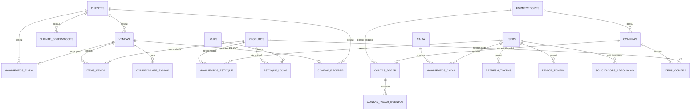

# Banco de Dados

O Vertex ERP usa PostgreSQL como único banco suportado, acessado via SQLAlchemy 2.0 (`postgresql+psycopg://`). As tabelas são criadas e evoluídas por migrações do Alembic (`backend/migrations/`, não versionadas no git — ver [04-api.md](04-api.md) e o `CLAUDE.md` na raiz do repo para detalhes de como rodá-las).

Esta página documenta o schema como ele existe hoje, extraído diretamente dos 25 arquivos de model em `backend/app/models/` (22 ativos + 3 órfãos — ver seção final).

## Convenções gerais

- Toda tabela tem `id` inteiro autoincremento como chave primária.
- A maioria das entidades cadastrais (`clientes`, `fornecedores`, `categorias`, `produtos`) tem `ativo: bool` (default `True`) e `criado_em: datetime`.
- Campos de dinheiro são majoritariamente `Float` no banco (não `Numeric`), embora os schemas Pydantic usem `Decimal` na camada da API — exceção: `movimentos_fiado.valor` já usa `Numeric(12, 2)` diretamente no model.
- Exclusão é **inconsistente entre módulos**: alguns fazem soft-delete (marcam `ativo=False`), outros fazem hard-delete (`DELETE` de verdade). Isso está documentado tabela por tabela abaixo.
- Tabelas de auditoria/histórico (`contas_pagar_eventos`, `comprovante_envios`) são **append-only** por design: nunca têm `atualizado_em` nem soft-delete, porque cada linha registra um fato que já aconteceu e não deve ser editado.

## Tabelas ativas

### `users`
Usuários que fazem login no sistema.

| Coluna | Tipo | Observação |
|---|---|---|
| id | int PK | |
| nome | string(100) | |
| email | string(150) | único |
| senha | string(255) | hash bcrypt (`passlib`) |
| ativo | bool | default `True` |
| admin | bool | default `False` |

### `refresh_tokens`
Sessão de longa duração emitida no login, usada pelo app mobile pra manter login persistente e permitir "logout remoto"/revogação (o access token JWT sozinho não pode ser revogado antes de expirar).

| Coluna | Tipo | Observação |
|---|---|---|
| id | int PK | |
| usuario_id | int FK → users | |
| token | string(255) | único, indexado |
| dispositivo | string(120) | opcional |
| criado_em | datetime | |
| expira_em | datetime | |
| ultimo_uso_em | datetime | |
| revogado | bool | default `False` |

### `device_tokens`
Tokens de push notification (mobile) por usuário/aparelho.

| Coluna | Tipo | Observação |
|---|---|---|
| id | int PK | |
| usuario_id | int FK → users | |
| token | string(255) | único |
| plataforma | string(20) | default `"ANDROID"` |
| criado_em / atualizado_em | datetime | `atualizado_em` tem `onupdate` automático |

### `clientes`
| Coluna | Tipo | Observação |
|---|---|---|
| id | int PK | |
| nome | string(150) | |
| cpf_cnpj | string(20) | único, obrigatório no model (a API trata como opcional na criação) |
| telefone | string(20) | |
| email | string(150) | opcional |
| endereco | string(255) | opcional |
| cidade | string(100) | opcional |
| estado | string(2) | opcional |
| ativo | bool | |
| criado_em | datetime | |

Relacionamentos: `vendas` (1\:N com `Venda`), `observacoes` (1\:N com `ClienteObservacao`), `movimentos_fiado` (1\:N com `MovimentoFiado`). **Exclusão é soft-delete** (`ClienteRepository.excluir` só marca `ativo=False`).

### `cliente_observacoes`
Anotações de texto livre sobre um cliente, feitas por um usuário (ex.: histórico de atendimento).

| Coluna | Tipo | Observação |
|---|---|---|
| id | int PK | |
| cliente_id | int FK → clientes | `ondelete="CASCADE"` |
| usuario_id | int FK → users | |
| texto | string(1000) | |
| criado_em | datetime | |

### `movimentos_fiado`
Lançamentos de fiado/crediário do cliente (venda fiada, pagamento parcial/total).

| Coluna | Tipo | Observação |
|---|---|---|
| id | int PK | |
| cliente_id | int FK → clientes | |
| venda_id | int FK → vendas | opcional, `ondelete="SET NULL"` |
| usuario_id | int FK → users | |
| tipo | string(20) | texto livre |
| forma_pagamento | string(20) | opcional |
| valor | numeric(12,2) | único campo monetário que já usa `Numeric` em vez de `Float` |
| descricao | string(255) | opcional |
| data | datetime | |

### `fornecedores` ⚠️ órfão — ver [seção final](#models-órfãos-não-usados)

### `categorias`
| Coluna | Tipo | Observação |
|---|---|---|
| id | int PK | |
| nome | string(100) | único |
| descricao | string(255) | opcional |
| ativo | bool | |
| criado_em | datetime | |

**Exclusão é hard-delete.**

### `categorias_despesa`
Categorias usadas para classificar despesas (contas a pagar) — tabela separada de `categorias` (que é de produtos).

| Coluna | Tipo | Observação |
|---|---|---|
| id | int PK | |
| nome | string(60) | único |
| criado_em | datetime | |

### `produtos`
| Coluna | Tipo | Observação |
|---|---|---|
| id | int PK | |
| codigo | string(30) | único |
| codigo_barras | string(50) | único, opcional |
| nome | string(150) | |
| descricao | string(255) | opcional |
| categoria | string(100) | texto livre, **não é FK** para `categorias` |
| preco_custo / preco_venda | float | default 0 |
| estoque / estoque_minimo | int | default 0 — **fonte de verdade legada**, ver `estoque_lojas` abaixo |
| unidade | string(10) | default `"UN"` |
| ativo | bool | |
| criado_em | datetime | |

**Exclusão é hard-delete.** O campo `categoria` é uma string livre — apesar de existir a tabela `categorias`, produtos não têm uma FK real para ela (débito técnico conhecido, ver `docs/06-roadmap.md`).

### `lojas`
Suporte a múltiplas lojas — cadastro básico ainda em construção.

| Coluna | Tipo | Observação |
|---|---|---|
| id | int PK | |
| nome | string(100) | |
| ativa | bool | default `True` |
| criado_em | datetime | |

### `estoque_lojas`
Quantidade de um produto numa loja específica. O catálogo (`Produto`: nome/código/preço) continua único e compartilhado entre lojas — só a quantidade física e o mínimo de alerta viram por loja. **`Produto.estoque`/`estoque_minimo` ainda existem e continuam sendo lidos por vários services/telas** — a migração pra usar `estoque_lojas` como fonte de verdade única está em andamento, endpoint por endpoint, não está completa.

| Coluna | Tipo | Observação |
|---|---|---|
| id | int PK | |
| produto_id | int FK → produtos | |
| loja_id | int FK → lojas | |
| quantidade | int | default 0 |
| estoque_minimo | int | default 0 |

Constraint única em `(produto_id, loja_id)`.

### `compras` ⚠️ órfão — ver [seção final](#models-órfãos-não-usados)

### `itens_compra` ⚠️ órfão — ver [seção final](#models-órfãos-não-usados)

### `vendas`
| Coluna | Tipo | Observação |
|---|---|---|
| id | int PK | |
| cliente_id | int FK → clientes | opcional (venda de "Consumidor Final") |
| data | datetime | default agora |
| valor_total | float | soma dos itens menos desconto |
| desconto | float | default 0 |
| observacao | string(255) | opcional |
| status | string(20) | default `"FINALIZADA"` |
| forma_pagamento | string(20) | default `"AVISTA"` no model — **na prática sempre gravado como um dos valores do enum `FormaPagamento`** (`DINHEIRO`, `PIX`, `DEBITO`, `CREDITO`, `BOLETO`, `PRAZO`); o default do model é um valor legado que não pertence mais ao enum |
| data_vencimento | datetime | opcional, usada com `PRAZO` |

Relacionamentos: `cliente` (N:1), `itens` (1\:N com `ItemVenda`, `cascade="all, delete-orphan"`). Criar uma venda baixa o estoque dos produtos; excluir uma venda (cancelamento) devolve o estoque e faz **hard-delete** da linha.

### `itens_venda`
| Coluna | Tipo |
|---|---|
| id | int PK |
| venda_id | int FK → vendas |
| produto_id | int FK → produtos |
| quantidade | int |
| valor_unitario | float |
| subtotal | float |

### `comprovante_envios`
Auditoria de cada tentativa de envio de comprovante de venda (WhatsApp ou e-mail) — **nunca apagado, nem quando o envio falha**: o histórico da falha importa pra conferir depois se o cliente recebeu ou não.

| Coluna | Tipo | Observação |
|---|---|---|
| id | int PK | |
| venda_id | int FK → vendas | `ondelete="CASCADE"` |
| usuario_id | int FK → users | opcional |
| canal | string(20) | `WHATSAPP` \| `EMAIL` |
| destino | string(150) | telefone ou e-mail |
| status | string(20) | `ENVIADO` \| `FALHOU` |
| erro | string(255) | opcional, preenchido quando `FALHOU` |
| data | datetime | |

### `caixa`
Um caixa por período de operação (abertura → fechamento).

| Coluna | Tipo | Observação |
|---|---|---|
| id | int PK | |
| data_abertura | datetime | |
| data_fechamento | datetime | opcional (nulo enquanto aberto) |
| saldo_inicial | float | |
| saldo_final | float | atualizado a cada `MovimentoCaixa` |
| status | string(20) | `"ABERTO"` \| `"FECHADO"` (texto livre) |

Regra de negócio: só pode existir **um caixa `ABERTO` por vez** em todo o sistema.

### `movimentos_caixa`
Lançamentos dentro de um caixa aberto (sangria, suprimento, venda, recebimento, pagamento).

| Coluna | Tipo |
|---|---|
| id | int PK |
| caixa_id | int FK → caixa |
| usuario_id | int FK → users |
| data | datetime |
| tipo | string(20) — `ENTRADA`/`SUPRIMENTO`/`VENDA`/`RECEBIMENTO` somam ao saldo; `SAIDA`/`SANGRIA`/`PAGAMENTO` subtraem |
| descricao | string(255) opcional |
| valor | float |

### `movimentos_estoque`
Ajustes manuais de estoque (entrada/saída fora do fluxo normal de compra/venda).

| Coluna | Tipo |
|---|---|
| id | int PK |
| produto_id | int FK → produtos |
| usuario_id | int FK → users |
| tipo | string(20) — `ENTRADA` \| `SAIDA` |
| quantidade | int |
| motivo | string(255) opcional |
| data | datetime |

### `contas_pagar`
| Coluna | Tipo | Observação |
|---|---|---|
| id | int PK | |
| fornecedor_id | int FK → fornecedores | opcional — aponta pra uma tabela órfã, mas a coluna em si segue em uso |
| compra_id | int FK → compras | opcional; legado de quando o fluxo de Compras existia |
| data_emissao | datetime | |
| data_vencimento | datetime | |
| data_pagamento | datetime | opcional |
| valor | float | |
| observacao | string(255) | opcional |
| status | string(20) | `PENDENTE` \| `PAGO` \| `CANCELADO` (enum `StatusContaPagar`) |

Pagar uma conta gera um `MovimentoCaixa` do tipo `PAGAMENTO` (valor negativo) no caixa aberto — **exige caixa aberto**.

### `contas_pagar_eventos`
Linha do tempo de auditoria de uma despesa — quem fez o quê e quando (`CRIADA`, `DOCUMENTO_ANEXADO`, `PAGA`, `COMPROVANTE_ANEXADO`, `COMPROVANTE_TROCADO`, `CANCELAMENTO_SOLICITADO`, `CANCELADA`). Só cresce, nunca é editada/apagada.

| Coluna | Tipo | Observação |
|---|---|---|
| id | int PK | |
| conta_pagar_id | int FK → contas_pagar | `ondelete="CASCADE"` |
| tipo | string(40) | ver valores acima |
| usuario_id | int FK → users | opcional |
| dispositivo | string(60) | opcional (ex.: "Android", "Desktop") |
| detalhes | string(255) | opcional |
| data | datetime | |

### `contas_receber`
| Coluna | Tipo | Observação |
|---|---|---|
| id | int PK | |
| cliente_id | int FK → clientes | |
| venda_id | int FK → vendas | opcional; preenchido quando gerada automaticamente por uma venda a prazo |
| data_emissao | datetime | |
| data_vencimento | datetime | |
| data_recebimento | datetime | opcional |
| valor | float | |
| observacao | string(255) | opcional |
| status | string(20) | `PENDENTE` \| `RECEBIDO` \| `CANCELADO` (enum `StatusContaReceber`) |

Receber uma conta gera um `MovimentoCaixa` do tipo `RECEBIMENTO` (valor positivo) — **exige caixa aberto**.

### `configuracoes`
Configurações globais da loja (dados do comprovante, PIX, SMTP, integração WhatsApp via Z-API). Tabela sem FK, tipicamente uma única linha.

| Coluna | Tipo | Observação |
|---|---|---|
| id | int PK | |
| nome_loja / cnpj_cpf / endereco / telefone | string | opcionais |
| pix_chave / pix_nome / pix_cidade | string | opcionais |
| logo_filename | string(255) | opcional |
| logo | bytes (`LargeBinary`) | opcional — logo de verdade do comprovante; `logo_filename` nunca foi ligado a upload nenhum |
| smtp_host / smtp_porta / smtp_usuario / smtp_senha / smtp_remetente | string/int | credencial de terceiro (ex. Gmail) pro "Enviar por E-mail" do comprovante |
| smtp_ativo | bool | default `False` |
| whatsapp_instance_id / whatsapp_token | string | credencial da instância Z-API |
| whatsapp_ativo | bool | default `False` |
| whatsapp_lembrete_fiado_ativo | bool | default `False` |
| whatsapp_lembrete_fiado_dias | int | default 30 |
| whatsapp_comprovante_venda_ativo | bool | default `False` |

### `solicitacoes_aprovacao`
Uma ação sensível pedida por um operador (não-admin) que fica parada até um administrador aprovar ou rejeitar — pensada pra ser aprovada pelo celular, sem o gerente precisar estar no caixa. O campo `tipo` decide qual ação de verdade roda quando aprovada (ver `AprovacaoService._executar`).

| Coluna | Tipo | Observação |
|---|---|---|
| id | int PK | |
| tipo | string(40) | ex.: `EXCLUIR_CLIENTE`, outros tipos entrando com o tempo |
| referencia_id | int | id do registro alvo da ação |
| descricao | string(255) | |
| status | string(20) | default `"PENDENTE"`, indexado |
| solicitante_id | int FK → users | |
| aprovador_id | int FK → users | opcional, preenchido na resolução |
| criado_em | datetime | |
| resolvido_em | datetime | opcional |

## Models órfãos (não usados)

Estes 3 models existem no disco e têm tabela correspondente no banco, mas **não têm router registrado em `main.py`** — o módulo de Compras/Fornecedores foi removido do sistema a pedido do usuário (ver `CLAUDE.md`). Não trate como domínio ativo; não desenvolva feature nova em cima deles sem confirmar antes.

### `fornecedores`
| Coluna | Tipo | Observação |
|---|---|---|
| id | int PK | |
| razao_social | string(200) | |
| nome_fantasia | string(200) | opcional |
| cnpj | string(20) | único |
| email | string(150) | opcional |
| telefone | string(30) | opcional |
| cidade / estado | string | opcionais |
| ativo | bool | |
| criado_em | datetime | |

Ainda referenciado por `contas_pagar.fornecedor_id` (coluna opcional, em uso mesmo com o módulo desligado).

### `compras`
| Coluna | Tipo | Observação |
|---|---|---|
| id | int PK | |
| fornecedor_id | int FK → fornecedores | |
| data | datetime | default agora |
| valor_total | float | calculado a partir dos itens |
| observacao | string(255) | opcional |
| status | string(20) | default `"FINALIZADA"` (texto livre, sem enum aplicado) |
| forma_pagamento | string(20) | default `"DINHEIRO"` |
| data_vencimento | datetime | opcional, usada quando `forma_pagamento="PRAZO"` |

Ainda referenciado por `contas_pagar.compra_id` (coluna opcional legada).

### `itens_compra`
| Coluna | Tipo |
|---|---|
| id | int PK |
| compra_id | int FK → compras |
| produto_id | int FK → produtos |
| quantidade | int |
| valor_unitario | float |
| subtotal | float |

## Enums (`app/enums/`)

Nem todo enum do diretório está de fato conectado a uma coluna do banco — vários são placeholders vazios deixados para uso futuro.

| Enum | Valores | Em uso? |
|---|---|---|
| `FormaPagamento` | DINHEIRO, PIX, DEBITO, CREDITO, BOLETO, PRAZO | Sim — `Venda.forma_pagamento` e `Compra.forma_pagamento` (órfão) |
| `StatusContaPagar` | PENDENTE, PAGO, CANCELADO | Sim |
| `StatusContaReceber` | PENDENTE, RECEBIDO, CANCELADO | Sim |
| `TipoMovimentoCaixa` | VENDA, SUPRIMENTO, SANGRIA, RECEBIMENTO, PAGAMENTO, AJUSTE | Parcialmente — o campo `tipo` de `MovimentoCaixa` é string livre, a checagem de soma/subtração no service usa esses valores como texto, não o enum em si |
| `TipoMovimentoEstoque` | ENTRADA, SAIDA | Sim — `MovimentoEstoque.tipo` |
| `StatusVenda` | ABERTA, FINALIZADA, CANCELADA | **Não usado** — `Venda.status` é string livre com default `"FINALIZADA"` |
| `StatusCompra`, `StatusCaixa`, `PerfilUsuario`, `TipoDocumento` | — | **Arquivos vazios**, não implementados |

## Diagrama de relacionamentos (simplificado)

