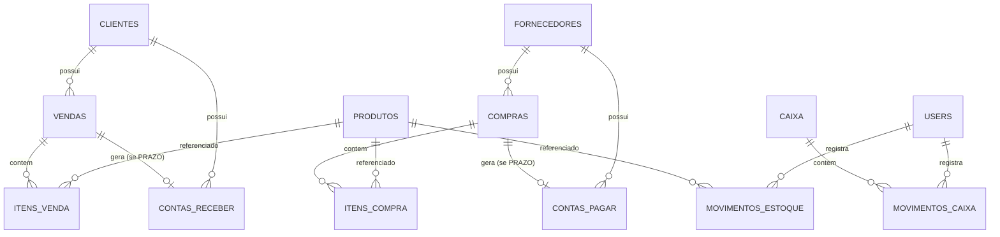

# Banco de Dados

O Vertex ERP usa PostgreSQL como único banco suportado, acessado via SQLAlchemy 2.0 (`postgresql+psycopg://`). As tabelas são criadas e evoluídas por migrações do Alembic (`backend/migrations/`, não versionadas no git — ver [04-api.md](04-api.md) e o `CLAUDE.md` na raiz do repo para detalhes de como rodá-las).

Esta página documenta o schema como ele existe hoje, extraído diretamente dos models em `backend/app/models/`.

## Convenções gerais

- Toda tabela tem `id` inteiro autoincremento como chave primária.
- A maioria das entidades cadastrais (`clientes`, `fornecedores`, `categorias`, `produtos`) tem `ativo: bool` (default `True`) e `criado_em: datetime`.
- Campos de dinheiro são `Float` no banco (não `Numeric`), embora os schemas Pydantic usem `Decimal` na camada da API.
- Exclusão é **inconsistente entre módulos**: alguns fazem soft-delete (marcam `ativo=False`), outros fazem hard-delete (`DELETE` de verdade). Isso está documentado tabela por tabela abaixo.

## Tabelas

### `users`
Usuários que fazem login no sistema.

| Coluna | Tipo | Observação |
|---|---|---|
| id | int PK | |
| nome | string(100) | |
| email | string(150) | único |
| senha | string(255) | hash bcrypt (`passlib`) |
| ativo | bool | default `True` |
| admin | bool | default `False` |

### `clientes`
| Coluna | Tipo | Observação |
|---|---|---|
| id | int PK | |
| nome | string(150) | |
| cpf_cnpj | string(20) | único, obrigatório no model (a API trata como opcional na criação) |
| telefone | string(20) | |
| email | string(150) | opcional |
| endereco | string(255) | opcional |
| cidade | string(100) | opcional |
| estado | string(2) | opcional |
| ativo | bool | |
| criado_em | datetime | |

Relacionamento: `vendas` (1\:N com `Venda`). **Exclusão é soft-delete** (`ClienteRepository.excluir` só marca `ativo=False`).

### `fornecedores`
| Coluna | Tipo | Observação |
|---|---|---|
| id | int PK | |
| razao_social | string(200) | |
| nome_fantasia | string(200) | opcional |
| cnpj | string(20) | único |
| email | string(150) | opcional |
| telefone | string(30) | opcional |
| cidade / estado | string | opcionais |
| ativo | bool | |
| criado_em | datetime | |

Relacionamento: `compras` (1\:N, `cascade="all, delete-orphan"`). **Exclusão é hard-delete.** CNPJ duplicado retorna `409` (tratado via `IntegrityError` capturada no repository).

### `categorias`
| Coluna | Tipo | Observação |
|---|---|---|
| id | int PK | |
| nome | string(100) | único |
| descricao | string(255) | opcional |
| ativo | bool | |
| criado_em | datetime | |

**Exclusão é hard-delete.**

### `produtos`
| Coluna | Tipo | Observação |
|---|---|---|
| id | int PK | |
| codigo | string(30) | único |
| codigo_barras | string(50) | único, opcional |
| nome | string(150) | |
| descricao | string(255) | opcional |
| categoria | string(100) | texto livre, **não é FK** para `categorias` |
| preco_custo / preco_venda | float | default 0 |
| estoque / estoque_minimo | int | default 0 |
| unidade | string(10) | default `"UN"` |
| ativo | bool | |
| criado_em | datetime | |

**Exclusão é hard-delete.** O campo `categoria` é uma string livre — apesar de existir a tabela `categorias`, produtos não têm uma FK real para ela.

### `compras`
| Coluna | Tipo | Observação |
|---|---|---|
| id | int PK | |
| fornecedor_id | int FK → fornecedores | |
| data | datetime | default agora |
| valor_total | float | calculado a partir dos itens |
| observacao | string(255) | opcional |
| status | string(20) | default `"FINALIZADA"` (texto livre, sem enum aplicado) |
| forma_pagamento | string(20) | default `"DINHEIRO"` (adicionada nesta sessão — ver roadmap) |
| data_vencimento | datetime | opcional, usada quando `forma_pagamento="PRAZO"` |

Relacionamentos: `fornecedor` (N:1), `itens` (1\:N com `ItemCompra`, `cascade="all, delete-orphan"`). Ao excluir uma compra, o estoque dos produtos dos itens é devolvido antes do delete.

### `itens_compra`
| Coluna | Tipo |
|---|---|
| id | int PK |
| compra_id | int FK → compras |
| produto_id | int FK → produtos |
| quantidade | int |
| valor_unitario | float |
| subtotal | float |

### `vendas`
| Coluna | Tipo | Observação |
|---|---|---|
| id | int PK | |
| cliente_id | int FK → clientes | opcional (venda de "Consumidor Final") |
| data | datetime | default agora |
| valor_total | float | soma dos itens menos desconto |
| desconto | float | default 0 |
| observacao | string(255) | opcional |
| status | string(20) | default `"FINALIZADA"` |
| forma_pagamento | string(20) | default `"AVISTA"` no model — **na prática sempre gravado como um dos valores do enum `FormaPagamento`** (`DINHEIRO`, `PIX`, `DEBITO`, `CREDITO`, `BOLETO`, `PRAZO`); o default do model é um valor legado que não pertence mais ao enum |
| data_vencimento | datetime | opcional, usada com `PRAZO` |

Relacionamentos: `cliente` (N:1), `itens` (1\:N com `ItemVenda`, `cascade="all, delete-orphan"`). Criar uma venda baixa o estoque dos produtos; excluir uma venda (cancelamento) devolve o estoque e faz **hard-delete** da linha.

### `itens_venda`
| Coluna | Tipo |
|---|---|
| id | int PK |
| venda_id | int FK → vendas |
| produto_id | int FK → produtos |
| quantidade | int |
| valor_unitario | float |
| subtotal | float |

### `caixa`
Um caixa por período de operação (abertura → fechamento).

| Coluna | Tipo | Observação |
|---|---|---|
| id | int PK | |
| data_abertura | datetime | |
| data_fechamento | datetime | opcional (nulo enquanto aberto) |
| saldo_inicial | float | |
| saldo_final | float | atualizado a cada `MovimentoCaixa` |
| status | string(20) | `"ABERTO"` \| `"FECHADO"` (texto livre) |

Regra de negócio: só pode existir **um caixa `ABERTO` por vez** em todo o sistema.

### `movimentos_caixa`
Lançamentos dentro de um caixa aberto (sangria, suprimento, venda, recebimento, pagamento).

| Coluna | Tipo |
|---|---|
| id | int PK |
| caixa_id | int FK → caixa |
| usuario_id | int FK → users |
| data | datetime |
| tipo | string(20) — `ENTRADA`/`SUPRIMENTO`/`VENDA`/`RECEBIMENTO` somam ao saldo; `SAIDA`/`SANGRIA`/`PAGAMENTO` subtraem |
| descricao | string(255) opcional |
| valor | float |

### `movimentos_estoque`
Ajustes manuais de estoque (entrada/saída fora do fluxo normal de compra/venda). Tabela adicionada nesta sessão.

| Coluna | Tipo |
|---|---|
| id | int PK |
| produto_id | int FK → produtos |
| usuario_id | int FK → users |
| tipo | string(20) — `ENTRADA` \| `SAIDA` |
| quantidade | int |
| motivo | string(255) opcional |
| data | datetime |

### `contas_pagar`
| Coluna | Tipo | Observação |
|---|---|---|
| id | int PK | |
| fornecedor_id | int FK → fornecedores | opcional |
| compra_id | int FK → compras | opcional; preenchido quando gerada automaticamente por uma compra a prazo |
| data_emissao | datetime | |
| data_vencimento | datetime | |
| data_pagamento | datetime | opcional |
| valor | float | |
| observacao | string(255) | opcional |
| status | string(20) | `PENDENTE` \| `PAGO` \| `CANCELADO` (enum `StatusContaPagar`) |

Pagar uma conta gera um `MovimentoCaixa` do tipo `PAGAMENTO` (valor negativo) no caixa aberto — **exige caixa aberto**.

### `contas_receber`
| Coluna | Tipo | Observação |
|---|---|---|
| id | int PK | |
| cliente_id | int FK → clientes | |
| venda_id | int FK → vendas | opcional; preenchido quando gerada automaticamente por uma venda a prazo |
| data_emissao | datetime | |
| data_vencimento | datetime | |
| data_recebimento | datetime | opcional |
| valor | float | |
| observacao | string(255) | opcional |
| status | string(20) | `PENDENTE` \| `RECEBIDO` \| `CANCELADO` (enum `StatusContaReceber`) |

Receber uma conta gera um `MovimentoCaixa` do tipo `RECEBIMENTO` (valor positivo) — **exige caixa aberto**.

## Enums (`app/enums/`)

Nem todo enum do diretório está de fato conectado a uma coluna do banco — vários são placeholders vazios deixados para uso futuro.

| Enum | Valores | Em uso? |
|---|---|---|
| `FormaPagamento` | DINHEIRO, PIX, DEBITO, CREDITO, BOLETO, PRAZO | Sim — `Venda.forma_pagamento` e `Compra.forma_pagamento` |
| `StatusContaPagar` | PENDENTE, PAGO, CANCELADO | Sim |
| `StatusContaReceber` | PENDENTE, RECEBIDO, CANCELADO | Sim |
| `TipoMovimentoCaixa` | VENDA, SUPRIMENTO, SANGRIA, RECEBIMENTO, PAGAMENTO, AJUSTE | Parcialmente — o campo `tipo` de `MovimentoCaixa` é string livre, a checagem de soma/subtração no service usa esses valores como texto, não o enum em si |
| `TipoMovimentoEstoque` | ENTRADA, SAIDA | Sim — `MovimentoEstoque.tipo` |
| `StatusVenda` | ABERTA, FINALIZADA, CANCELADA | **Não usado** — `Venda.status` é string livre com default `"FINALIZADA"` |
| `StatusCompra`, `StatusCaixa`, `PerfilUsuario`, `TipoDocumento` | — | **Arquivos vazios**, não implementados |

## Diagrama de relacionamentos (simplificado)

